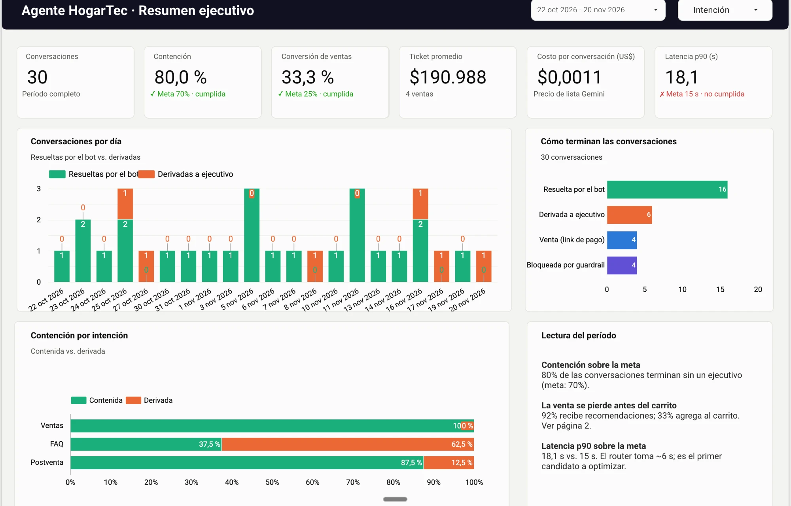
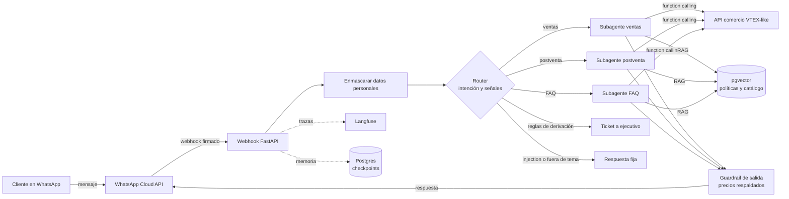

# Agente de compra y postventa por WhatsApp

[](https://github.com/JulioPradenas/agente-comercio-whatsapp/actions/workflows/ci.yml)

Agente conversacional en producción para una tienda online de electro y hogar (HogarTec, ficticia).
Atiende por WhatsApp: recomienda productos, arma el carrito y entrega el link de pago, informa el estado
de pedidos, gestiona devoluciones según la política y deriva a un ejecutivo cuando corresponde.

El proyecto cubre el ciclo completo de un producto de IA conversacional: diseño del agente, integración
con un comercio tipo VTEX, canal real de WhatsApp, guardrails, evaluación automatizada en CI,
observabilidad de costo y latencia, y KPIs de negocio.

| | |
|---|---|
| **Demo** | Video de 2 minutos: _(pendiente)_ |
| **Dashboard de KPIs** | [Looker Studio](https://datastudio.google.com/s/iz6B29uACno) · [guía de construcción](docs/dashboard_guide.html) |
| **Detalle técnico** | [docs/technical.md](docs/technical.md) |
| **Producto** | [PRD](docs/product/prd.md) · [diseño conversacional](docs/product/conversation_design.md) · [backlog](docs/product/backlog_guide.md) |



## Resultados

| Dimensión | Métrica | Resultado |
|---|---|---|
| Calidad | Evaluación de punta a punta (30 casos): ruta y herramientas correctas | **30/30** |
| Calidad | LLM-as-judge: relevancia / fidelidad a los datos / tono (1-5) | **5,00 / 5,00 / 4,80** |
| Seguridad | Set adversarial: injection y fuera de tema bloqueados, sin falsos positivos | **16/16** |
| Negocio | Contención (conversaciones sin ejecutivo) | **80%** |
| Negocio | Conversión de conversaciones de venta a link de pago | **33%** |
| Negocio | Ticket promedio de las ventas del bot | **$190.988** |
| Eficiencia | Costo por conversación (precio de lista de Gemini) | **US$0,0011** |
| Eficiencia | Latencia por respuesta, p50 / p90 | **9,9 s / 18,1 s** |

Los KPIs de negocio vienen de 30 conversaciones simuladas contra el agente real: el comportamiento del
agente, el costo y la latencia son reales; la mezcla de clientes es simulada, así que contención y
conversión cambiarían con tráfico real.

## Arquitectura



Un router clasifica cada mensaje con salida estructurada y lo envía a un subagente con su propio prompt
y **solo sus herramientas**. El estado de la conversación (carrito, historial, derivaciones) vive en
Postgres, así que sobrevive a reinicios del servidor.

## Decisiones de diseño

| Decisión | Por qué |
|---|---|
| **El LLM detecta señales; el código decide** | El router extrae "pide una persona", "frustración alta", "amenaza legal"; las reglas que derivan son código testeable, acordable con Atención a Clientes. |
| **Montos y fechas se calculan en código** | Las herramientas devuelven "$269.990" y "atrasado 3 días hábiles" ya calculados. Los LLM fallan en aritmética y no saben qué día es hoy. |
| **El teléfono del cliente nunca es un parámetro del LLM** | Viene de la sesión de WhatsApp. El modelo no puede ser manipulado para consultar pedidos ajenos; un test lo verifica. |
| **Reglas de negocio en la API, no en el prompt** | El plazo de 10 días para devolver o el dueño del pedido se validan en la API: una devolución inválida no se puede crear, diga lo que diga el modelo. |
| **Guardrails en capas** | Entrada (datos personales, tarjetas, injection), herramientas con mínimo privilegio por subagente y salida (todo precio debe venir de una herramienta). |
| **Lo obligatorio se fuerza por configuración** | "Consulta siempre la política" falló como instrucción de prompt; se resolvió obligando la llamada a la herramienta. |
| **Evaluación antes de cambiar** | Cada cambio de prompt pasa por 30 casos de punta a punta con juez; la evaluación encontró 4 fallas que los tests unitarios no veían. |
| **Costo a precio de lista** | Hoy se usa el tier gratuito, pero el KPI refleja lo que costaría en producción. |

## Stack

| Capa | Tecnología |
|---|---|
| LLM | Gemini (Google Gen AI SDK, mismo código para AI Studio y Vertex AI) con modelo de respaldo y timeout |
| Orquestación | LangGraph: router, 3 subagentes, derivación a humano, guardrails |
| RAG | Supabase Postgres + pgvector, `gemini-embedding-001`, búsqueda híbrida (filtros SQL + embeddings) |
| Comercio | API simulada con la forma de VTEX (Catalog, Logistics, Checkout, OMS) + colección Postman |
| Canal | WhatsApp Cloud API: webhook con firma HMAC, deduplicación, procesamiento en segundo plano |
| Calidad | pytest (92 tests), golden set, set adversarial, LLM-as-judge, GitHub Actions |
| Observabilidad | Langfuse: traza por mensaje con latencia, tokens y costo |
| Analítica | BigQuery (vistas SQL de KPIs) + Looker Studio |
| Despliegue | Docker en Render; memoria del agente en Postgres |

## Estructura

```
agent/            Router, subagentes, herramientas, guardrails, derivación, observabilidad
channels/         Webhook y cliente de WhatsApp Cloud API
commerce_api/     API de comercio con forma VTEX (FastAPI)
rag/              Chunking, embeddings, indexación y búsqueda en pgvector
db/               Migraciones SQL y carga de datos
data/             Generadores de datos sintéticos y políticas de la tienda
evals/            Golden set, set adversarial, evaluación del router y del agente con juez
analytics/        Simulador de conversaciones, carga a BigQuery y vistas de KPIs
docs/             Guía técnica, guía del dashboard, documentos de producto
tests/            Tests unitarios (sin red ni LLM)
```

## Correr localmente

```bash
uv sync
cp .env.example .env                                  # Gemini y Supabase
uv run python -m db.migrate && uv run python -m db.load_data && uv run python -m rag.indexer
uv run fastapi dev commerce_api/main.py --port 8001   # en otra terminal
uv run python -m agent.cli --interactive
```

Tests y evaluaciones:

```bash
uv run pytest                          # 92 tests, sin red ni LLM
uv run python -m evals.agent_eval      # 30 casos de punta a punta + juez
```

WhatsApp, despliegue, Langfuse y BigQuery: [docs/technical.md](docs/technical.md).

## Limitaciones y próximos pasos

| Hoy | A escala |
|---|---|
| Latencia p90 de 18 s; el router toma ~6 s solo para clasificar | Router con un modelo sin razonamiento o un clasificador propio; respuestas en streaming |
| Tier gratuito de Gemini: 15 solicitudes por minuto por modelo | Vertex AI con cuota pagada; el SDK ya es compatible |
| API de comercio simulada | Conectar VTEX real: solo cambia la URL base y las credenciales del adaptador |
| Número de prueba de Meta (5 destinatarios) | Número verificado del negocio y plantillas aprobadas para mensajes salientes |
| Bandeja de tickets en una tabla | Integración con la herramienta del equipo de atención (Zendesk, Freshdesk o similar) |
| KPIs sobre conversaciones simuladas | Eventos de producción hacia BigQuery y metas acordadas con negocio |
| Golden set escrito por el mismo autor | Casos escritos por Atención a Clientes y conversaciones reales anonimizadas |

## Datos

Todos los datos son sintéticos y reproducibles: catálogo de 300 productos, 200 clientes, 1.000 pedidos
y las políticas de la tienda. No hay datos personales reales.
