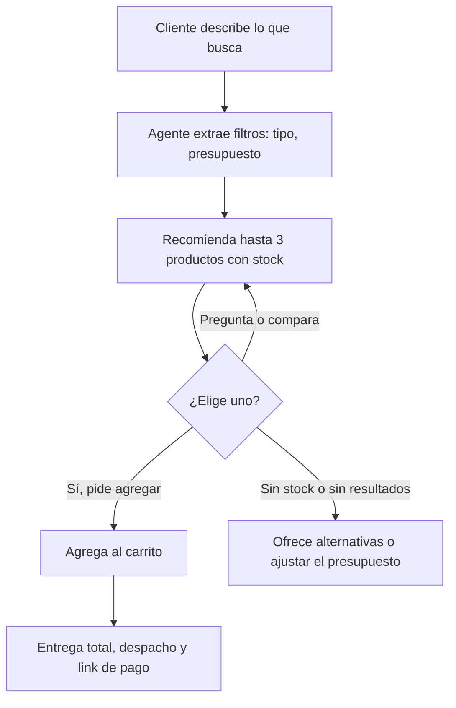
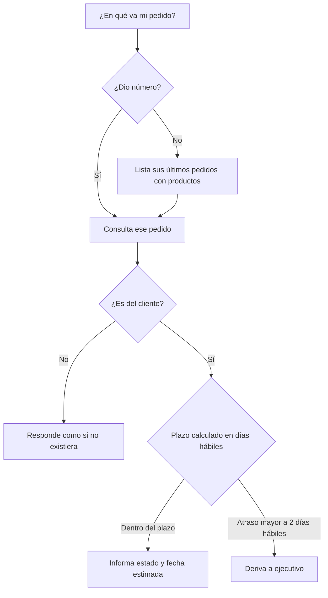
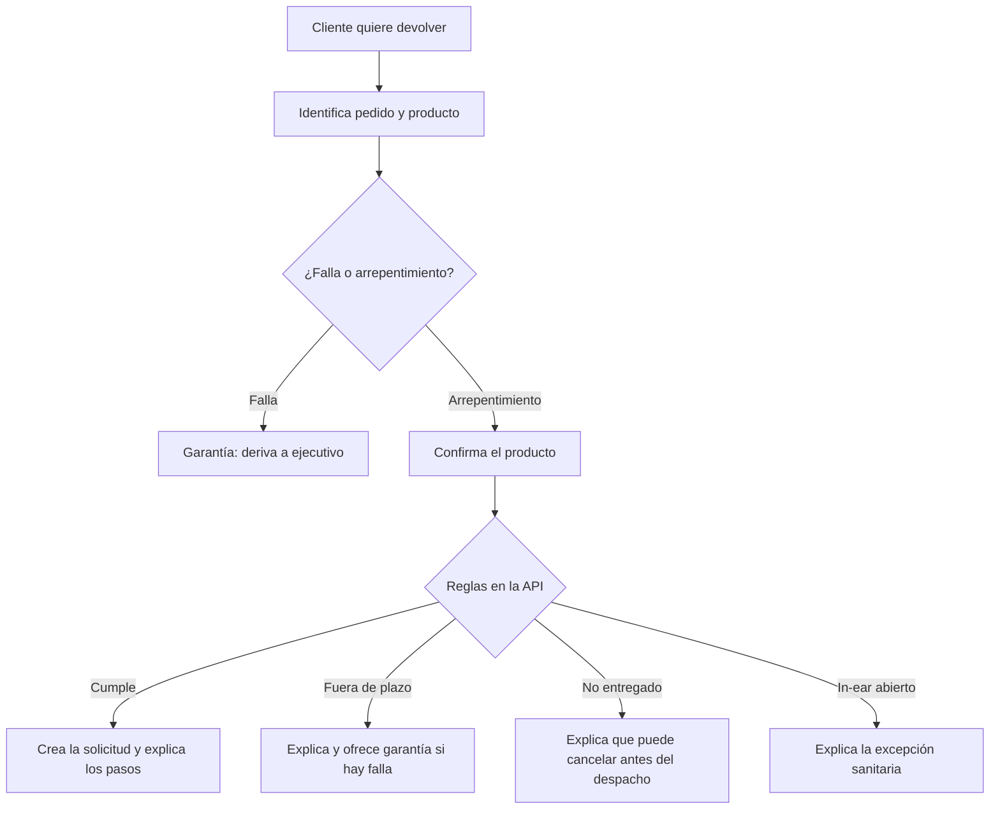
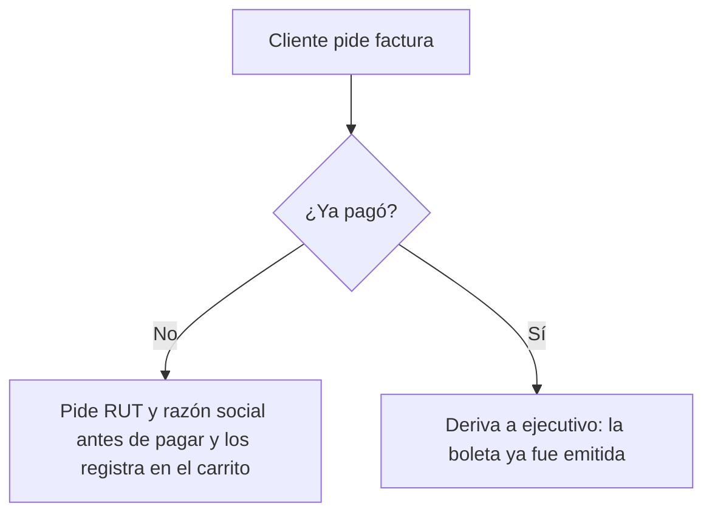

# Diseño conversacional: asistente de HogarTec en WhatsApp

> Los flujos, reglas y mensajes marcados **Implementado** están escritos tal como funcionan hoy
> (fuente: `agent/prompts.py`, `agent/guardrails.py`, `agent/handoff.py`). Los marcados **Diseñado** son
> decisiones tomadas que todavía no están en el código; están en el backlog. Si cambias un mensaje
> implementado, cámbialo también en el código y corre la evaluación.

## 1. Personalidad y tono

| | |
|---|---|
| **Nombre del asistente** | "Asistente de HogarTec", sin nombre propio. Un nombre de persona hace creer al cliente que habla con un humano; para un bot que deriva a ejecutivos, la transparencia evita confusiones al momento del traspaso. |
| **Rasgos** | Resolutivo, claro y cercano |
| **Registro** | Español de Chile, cordial, tuteo. Entiende chilenismos ("lucas", "refri", "pucha") sin imitarlos en exceso |
| **Largo** | Máximo 4–5 líneas por mensaje: es WhatsApp |

| Hace | No hace |
|---|---|
| Recomienda máximo 3 opciones con nombre, precio y lo que las diferencia | Muestra SKU ni códigos internos |
| Confirma antes de agregar al carrito o crear una devolución | Inventa precios, stock, plazos o estados |
| Usa negrita de WhatsApp con un asterisco (`*así*`) | Usa títulos, tablas o `**doble asterisco**` |
| Dice qué hará a continuación y con qué plazo | Repite el saludo en cada mensaje |
| Usa un solo emoji, ✅, al confirmar una acción completada (carrito, devolución, caso creado) | Usa emojis decorativos o en mensajes de reclamo, error o seguridad |

## 2. Mapa de intenciones

| Intención | Ejemplos reales | Atiende | Herramientas |
|---|---|---|---|
| Ventas | "busco un refri no frost grande, que no pase de 700 lucas" | Subagente de ventas | `search_products`, `check_stock`, `add_to_cart`, `search_policies` |
| Postventa | "en qué va mi pedido?", "quiero devolver los audífonos" | Subagente de postventa | `list_my_orders`, `get_order_status`, `request_return`, `search_policies` |
| FAQ | "cuánto cuesta el despacho?", "aceptan transferencia?" | Subagente de FAQ | `search_policies` (obligatoria en la primera respuesta) |
| Derivación | "quiero hablar con una persona", "voy al SERNAC" | Reglas del router | Ticket a ejecutivo |
| Seguridad | Datos de tarjeta, injection, fuera de tema | Guardrail | Respuesta fija, sin LLM |

## 3. Flujos principales

### Compra

### Estado de pedido

### Devolución

### Factura (diseñado)

El cambio de dirección no tiene flujo propio: se resuelve con la regla de derivación (pedido en preparación o
despachado) o se informa que puede cambiarse en el sitio mientras el pago esté pendiente.

## 4. Mensajes del sistema

| Situación | Mensaje | Estado |
|---|---|---|
| Bienvenida (primer mensaje del cliente) | "Hola, soy el asistente de HogarTec. Te ayudo a encontrar productos y comprar, revisar tus pedidos y resolver dudas de despacho, devoluciones y pagos. ¿Qué necesitas?" Se antepone a la primera respuesta solo si el mensaje es un saludo sin consulta. | Diseñado |
| Derivación a ejecutivo | "Te voy a derivar con un ejecutivo de atención al cliente para que lo revise en detalle. Tu número de caso es *HT-XXXXXX*. Te escribirá por este mismo chat en horario hábil (lunes a viernes, 9:00 a 18:00)." | Implementado |
| Fuera de horario | "Nuestro equipo atiende de lunes a viernes, de 9:00 a 18:00. Tu caso *HT-XXXXXX* quedó registrado y un ejecutivo te escribirá por este chat antes de las 11:00 del próximo día hábil." | Diseñado |
| Datos de tarjeta en el chat | "Por tu seguridad, no compartas datos de tarjetas por chat: no los guardamos y nunca te los pediremos por WhatsApp. Para pagar te enviamos un *link de pago seguro*. ¿Te ayudo con tu compra?" | Implementado |
| Intento de manipulación | "Solo puedo ayudarte con productos, pedidos y políticas de HogarTec, siguiendo las condiciones vigentes de la tienda. ¿En qué te puedo ayudar?" | Implementado |
| Fuera de tema | "Eso está fuera de lo que puedo hacer: soy el asistente de compras de HogarTec. Puedo ayudarte a buscar productos, revisar tus pedidos o resolver dudas de despacho, devoluciones y pagos." | Implementado |
| No pudo resolver | "Disculpa, no pude resolver tu consulta. ¿Me la puedes explicar de otra forma?" | Implementado; dos seguidos derivan a ejecutivo |
| Dato no confirmado (guardrail de salida) | "Disculpa, no pude confirmar ese dato con exactitud. ¿Me dices de nuevo qué producto o pedido te interesa y lo reviso?" | Implementado |
| Audio, imagen o sticker | "Por ahora solo puedo leer mensajes de texto. ¿Me escribes tu consulta?" | Implementado |
| Despedida y calificación | Tras 10 minutos sin mensajes del cliente después de una respuesta que resolvió la consulta: "¿Resolvimos tu consulta? Responde con un número del 1 al 5." Si responde 1 o 2: "Gracias por contarnos. ¿Quieres que te contacte un ejecutivo?" No se envía después de una derivación. | Diseñado |

## 5. Casos borde

| Caso | Comportamiento esperado | Estado |
|---|---|---|
| Producto sin stock | No se ofrece; se proponen alternativas | Implementado (búsqueda solo con stock) |
| Pedido de otra persona | Se responde igual que si no existiera | Implementado |
| Cliente cambia de tema a mitad de la compra | El carrito se conserva en la memoria de la conversación | Implementado |
| Mensajes muy seguidos | Se procesan en orden, uno a la vez por cliente | Implementado |
| Cliente escribe mientras lo atiende un ejecutivo | El bot no responde | Implementado |
| Varias preguntas en un mensaje | Responde todas en un solo mensaje, en el orden en que se hicieron, si caben en 5 líneas. Si una requiere una acción (comprar, devolver), resuelve primero las informativas y pide confirmación para la acción. | Diseñado |
| Cliente no responde a una pregunta del bot | No se envían recordatorios: un mensaje no solicitado fuera de la ventana de 24 horas requiere plantilla aprobada y puede molestar. El carrito y el contexto se conservan para cuando vuelva. | Diseñado |

## 6. Derivación: experiencia del cliente

- **Qué ve el cliente:** el número de caso y el horario en que responderá un ejecutivo (o el mensaje fuera de horario).
- **Qué ve el ejecutivo:** motivo, últimos mensajes del cliente y herramientas que consultó el bot.
- **Cuándo vuelve el bot:** cuando el ejecutivo cierra el caso.
- **Avisos al cliente:** cuando el ejecutivo toma el caso, su primer mensaje se presenta con nombre ("Hola, soy Camila, ejecutiva de HogarTec, y voy a revisar tu caso"). Cuando cierra el caso, el sistema envía: "Tu caso *HT-XXXXXX* quedó cerrado. Si necesitas algo más, escríbeme y te ayudo." Diseñado.

## 7. Componentes de WhatsApp

| Componente | Uso propuesto | Estado |
|---|---|---|
| Botones de respuesta (hasta 3) | Confirmar compra: "Sí, agregar" / "Ver otras opciones" | Fase 2, prioridad alta: es el paso del embudo con la mayor caída (recomendaciones → carrito) |
| Listas (hasta 10 opciones) | Elegir entre productos recomendados o entre pedidos | Fase 2, prioridad media |
| Plantillas (mensajes salientes) | Carrito abandonado, aviso de despacho | Requiere aprobación de Meta y consentimiento |

## 8. Cómo se valida este diseño

- Cada flujo tiene casos en `evals/golden_set.jsonl` y se evalúa en CI con un juez que califica relevancia,
  fidelidad a los datos y tono.
- Los mensajes de seguridad tienen casos en `evals/adversarial_set.jsonl`.
- Antes de cada cambio de mensajes, la jefatura de Atención a Clientes revisa los textos y escribe 5 casos
  nuevos para el golden set sin ver los prompts; se incorporan si el agente los resuelve como espera el negocio.
